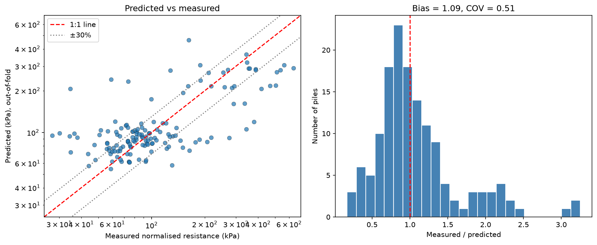

# Predicting normalised pile resistance from the CYCU load-test database

A self-study machine-learning project on drilled-shaft compression load tests. I wanted to learn how far basic pile and soil information can predict pile resistance, and how to test a model honestly on small geotechnical data.

**Short answer:** soil parameters from the database help (cross-validated R² about 0.26 → 0.44), but the model is not accurate enough for design. Typical predictions are off by a factor of about 1.7, and it under-predicts some very high-resistance piles.

## Question

Can pile geometry and soil information predict normalised pile resistance?

Normalised pile resistance (NPR) = Qmax / (π · B · L), in kPa. The model predicts `log(NPR)`.

Note: Qmax is the maximum applied test load. It is not always the true ultimate capacity, and NPR includes end bearing.

## Data

- CYCU pile load-test database, sheet "Drilled Shaft-Compression": 143 tests from about 81 sites.
- Source: the CYCU pile load test database, Chung Yuan Christian University (Chen, Topacio, Laveti, Jos, Hsiao), on Mendeley Data: <https://doi.org/10.17632/x6c63j8bv8.1> (CC BY 4.0). See "Data licence and citation" below.
- `Clean_dataset.xlsx` is my cleaned and modified copy of that sheet (see "Data decisions" for the changes).
- Some soil features were read from the linked borehole figures with the Gemini API (see "Gemini extraction" below).

## Method

- **Target:** `log(NPR)`.
- **No leakage:** Qmax, smax and all failure-criteria columns are never used as inputs.
- **Inputs:** pile length and diameter (L, B, L/B), groundwater depth, grain-size percentages, unit weight, vertical effective stress, undrained shear strength, soil class and construction tool, plus further columns in the larger feature sets.
- **Missing values:** median imputation with missing-value indicators for numbers; a "Missing" category for text columns.
- **Models:** a mean-only baseline (Dummy), Ridge (alpha = 10) and Random Forest (300 trees, max depth 8, min leaf 3).
- **Validation:** grouped cross-validation by site (`StratifiedGroupKFold`), so piles from the same site never appear in both training and test folds. 5 folds × 5 random seeds = 25 folds.

Feature sets compared: **Base** (9 features), **Extended** (17, adds soil parameters from the database), **Enriched** (21, adds features extracted from borehole figures), **Lean** (11, Extended without features that had negative permutation importance).

## Results

Cross-validated R² on `log(NPR)` (mean ± std over 25 folds):

| Feature set | Ridge | Random Forest |
|---|---|---|
| Base (9) | 0.25 ± 0.13 | 0.26 ± 0.22 |
| Extended (17) | 0.38 ± 0.14 | 0.44 ± 0.16 |
| Enriched (21) | 0.36 ± 0.14 | 0.44 ± 0.17 |
| Lean (11) | 0.34 ± 0.12 | 0.44 ± 0.17 |

- Soil parameters from the database raised R² by about 0.18 (random forest).
- The features extracted from borehole figures gave **no measurable gain** (0.439 → 0.444, inside the fold-to-fold spread).
- The Lean set matches Extended with fewer features, so I use **Lean + Random Forest** as the main model. Because I chose the Lean features using permutation importance on the same data, its score is slightly optimistic.
- Overfitting is clear: training R² is about 0.84, cross-validated R² about 0.44.

### Predicted vs measured (Lean, Random Forest, out-of-fold)



| Metric (measured ÷ predicted) | Value |
|---|---|
| R² on log(NPR), pooled | 0.459 |
| Bias (mean ratio) | 1.09 |
| COV | 0.51 |
| Median ratio | 0.96 |
| Piles within ±30% | 57% |

Typical error is a factor of about 1.7 (std of ln ratio about 0.5). The model is fair for ordinary piles, but it pulls predictions towards the average: it over-predicts very low resistances and under-predicts very high ones. **A COV of 0.51 is too large for design use.**

## Data decisions

I made these choices after checking the borehole figures and the original database. They are listed so that a reader can see they were not chosen to improve the score.

| Item | Decision | Reason |
|---|---|---|
| DC20-3 | Qmax set from 92,200 kN to 9,220 kN | The database value is 10× its three sibling piles (8,950–9,750 kN) and 10× all nine failure-criteria capacities in its own row (about 9,000 kN). Likely an extra digit. |
| DC12, DC6, DC38, DC16 | Figure-derived features set to missing (the piles stay in the data) | Figure did not match the pile (DC12, DC16), or the pile was longer than the soil profile (DC6, DC38). |
| SPT N | Capped at 100 | One value above 100 from the figure reading. |
| Groundwater depth | Capped at 50 m | One implausibly large value. |

For reference, with the original DC20-3 value the pooled results were bias 1.17, COV 0.79, within ±30% 58%. The one pile accounted for most of the difference in COV; the share of piles within ±30% did not change.

## Gemini extraction

Some borehole features (SPT N at the tip, CPT qc, groundwater ratio and similar) were read from the linked soil-profile figures with the Gemini API. The extraction cell in the notebook is disabled (it is a Markdown cell). Saved results are in `extracted_json/`, so you do not need an API key to run the notebook. The figures themselves are not included, because they come from the original publications of each test site.

To run the extraction again, convert that cell back to code, set your own key as an environment variable (`GEMINI_API_KEY`) and set `DOWNLOAD_IMAGES = True` in the download cell to fetch the figures (47 figure links). Never put the key in the notebook.

These values come from a language model reading figures, so they can contain errors. They did not improve the cross-validated accuracy.

## Limitations

- Small data: 143 piles, about 81 sites. Fold-to-fold spread is large.
- The model overfits and is not accurate enough for design.
- It under-predicts very high-resistance piles. The inputs do not capture site conditions such as strong base layers.
- Qmax is not always the true ultimate capacity.
- I did not compare the model with a physics-based design method.
- The database may contain other typing errors that I did not find.

## How to run

```
pip install -r requirements.txt
```

1. Keep `Clean_dataset.xlsx` and the `extracted_json/` folder in the same folder as the notebook (they are already there in this repository).
2. Open `pile_resistance_ml.ipynb` and run all cells. The Gemini cell is disabled and not needed.
3. `extra_experiments.ipynb` is optional (a PCA exploration, needs `plotly`). It is not part of the main result. The interactive PCA plot shows only when you run the notebook yourself, not on GitHub.

## Data licence and citation

The database is licensed under CC BY 4.0. `Clean_dataset.xlsx` in this repository is a modified copy (one sheet, cleaned, with the corrections listed under "Data decisions"). The original authors did not make or endorse these changes. My code is under the MIT licence.

Please cite the original database:

> Chen, Y.J., Topacio, A., Laveti, S., Jos, M.A.C., and Hsiao, M. CYCU pile load test database. Mendeley Data, V1, Chung Yuan Christian University, 2025. https://doi.org/10.17632/x6c63j8bv8.1

and the related chapter:

> Chen, Y.J., Topacio, A., Laveti, S., Jos, M.A.C., and Hsiao, M. (2024). Development and use of CYCU pile load test database. In: CRC Press, pp. 163–212. https://doi.org/10.1201/9781003441960-4

## Author

Md. Samiur Rahman Surid. B.Sc. in Civil Engineering (Geotechnical), BUET. This is a self-study project to learn machine learning for geotechnical data. Comments and corrections are welcome.
